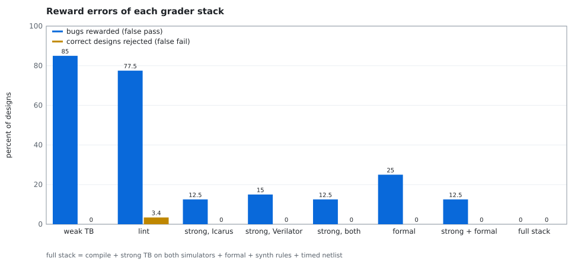
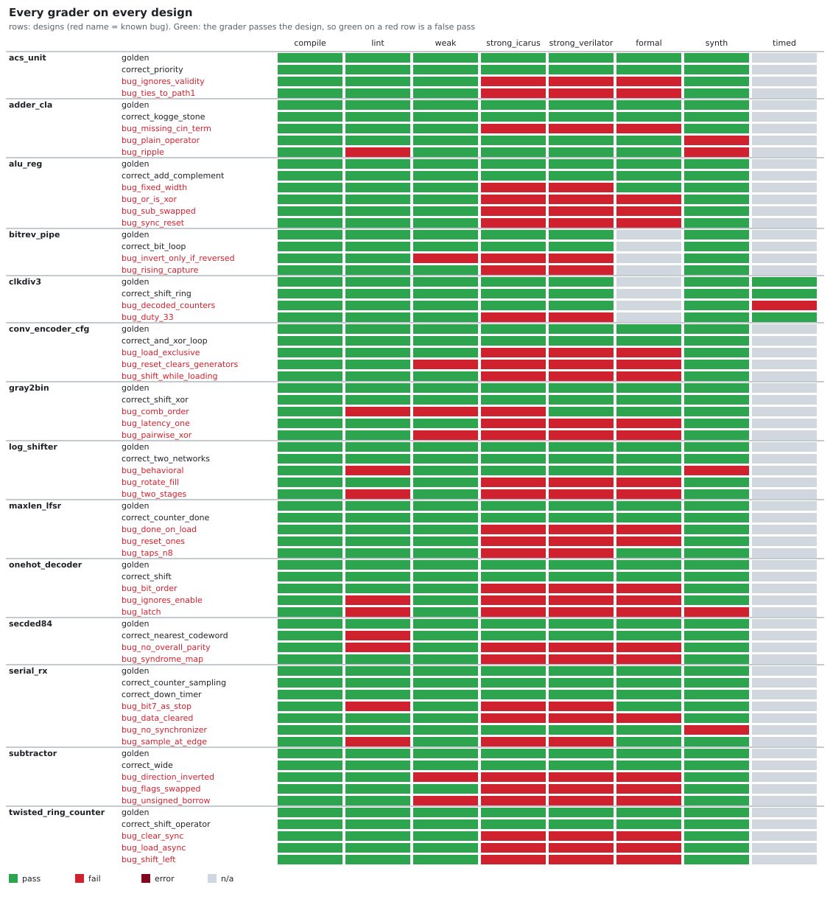

# RTL reward bench

[](https://github.com/r800360/rtl-reward-bench/actions/workflows/ci.yml)
[](LICENSE)

When a model learns to write hardware by reinforcement learning, the grader is the reward. A grader that passes a
buggy design teaches the model that the bug is fine; one that rejects a correct design throws away signal. This
repository measures both errors for eight common graders, from "it compiles" to formal equivalence and gate-level
simulation with random delays, on **14 SystemVerilog design tasks** and **69 designs** whose correctness is known:
29 correct (a golden design and alternative implementations) and 40 bugs, each labeled with what it gets wrong.
Every verdict is committed, and CI reruns every grader on every design and requires the same verdicts.



## Findings

| Reward | Bugs rewarded | Correct designs rejected |
|---|---|---|
| Weak testbench (a few directed vectors) | 34 of 40 (85 %) | 0 of 29 |
| Lint (`verilator -Wall`, no warnings) | 31 of 40 (78 %) | 1 of 29 |
| Strong testbench, Icarus | 5 of 40 (12 %) | 0 of 29 |
| Strong testbench, Verilator | 6 of 40 (15 %) | 0 of 29 |
| Formal equivalence alone (tasks that have it) | 9 of 36 (25 %) | 0 of 25 |
| Strong testbench in both simulators + formal | 5 of 40 (12 %) | 0 of 29 |
| Full stack (+ synthesis rules + timed gate-level simulation) | **0 of 40** | **0 of 29** |

* **A weak testbench is almost no reward.** It passes 85 % of the bugs: wrong tie-breaking in a Viterbi
  add-compare-select, a Hamming decoder that cannot detect double errors, a UART receiver that drops every byte
  with bit 7 = 0. Each passes because the few vectors happen to avoid the case.
* **The reward can depend on the simulator.** One Gray-code converter reads a bit of its own `always_comb` loop
  before computing it. The standard says the block is not re-triggered by its own writes, so Icarus produces stale
  values; Verilator settles the block like a network of gates and gets the right answer. The same file earns 0 or
  1 depending on the simulator.
* **Formal is only as good as its harness.** Equivalence checking is exhaustive, but each harness fixes one
  parameter value, so a 4-bit-only ALU and wrong LFSR taps for N = 8 pass it. The receiver's harness checks
  protocol properties, not the received byte, so two receiver bugs pass. The strong testbenches catch all four.
* **Five bugs are invisible to every functional grader**, because the requirement they break is not about
  function: a ripple-carry adder submitted as carry-lookahead, an adder written with `+` (Yosys gives 16 gate
  levels, the limit is 12), a shifter written with operators instead of the required multiplexers, a divide-by-3
  clock that glitches, and a receiver that uses an asynchronous input without a synchronizer. Both simulators pass
  all five and formal passes the four it applies to. A logic-depth limit, a structural rule, a synchronizer rule
  and a timed gate-level simulation catch them. Three of the five (the ripple adder, the glitching clock, the operators in the multiplexer-only shifter),
  and the receiver that drops half the bytes, are mistakes from my own coursework that received full marks.
* **Lint is a hint, not a reward.** Its warnings point at the bug in several designs (an enable or a shift-amount
  bit that is never read, a latch, an `always_comb` variable used before it is assigned), but it passes 31 of 40
  bugs and rejects a correct brute-force Hamming decoder for a width warning.
* **Cost is not where one expects.** On these small blocks a formal proof takes a median 0.26 s per design and the
  strong testbench in Icarus 0.03 s, while Verilator spends a median 17 s compiling C++ before it simulates anything
  ([figures/grader_seconds.svg](figures/grader_seconds.svg), one laptop). The reward environment runs the cheap
  graders first and stops at the first failure.



Per-design notes, every verdict and the lists of bugs each stack misses: [results/report.md](results/report.md).
How each grader runs: [docs/GRADERS.md](docs/GRADERS.md).

## The tasks

| Task | What is asked | Graders beyond simulation |
|---|---|---|
| `onehot_decoder` | N-to-2^N decoder with enable | formal |
| `alu_reg` | N-bit ALU, registered output, asynchronous reset | formal (PDR) |
| `twisted_ring_counter` | Johnson counter, asynchronous clear, synchronous load | formal (PDR) |
| `log_shifter` | shift/rotate in both directions, built only from `mux2` instances | formal, structure |
| `maxlen_lfsr` | maximal-length LFSR, N = 2…8, with load and a period pulse | formal (PDR) |
| `gray2bin` | registered Gray-to-binary converter | formal (PDR) |
| `adder_cla` | carry-lookahead adder, at most 12 gate levels at N = 16 | formal, logic depth |
| `clkdiv3` | glitch-free divide-by-3 clock with 50 % duty cycle | timed gate-level |
| `conv_encoder_cfg` | rate-1/2 convolutional encoder with loadable generators | formal (PDR) |
| `serial_rx` | UART receiver: mid-bit sampling, framing errors, synchronizer | formal (properties), synchronizer |
| `subtractor` | signed A − B or B − A with both overflow flags | formal |
| `secded84` | (8,4) extended Hamming decoder: correct one error, detect two | formal |
| `acs_unit` | Viterbi add-compare-select with predecessor validity | formal |
| `bitrev_pipe` | capture on the falling edge, reverse/invert on the rising edge | |

Each task is a folder: `spec.md` (what a model would be given), `golden.sv`, `tb_weak.sv`, `tb_strong.sv`,
`harness.sv` (formal), `task.json` (graders and parameters) and `candidates/`. A candidate's header says whether it
is correct or a bug, the class of bug and what it does wrong:

```systemverilog
// label: bug
// class: tie-breaking rule
// note: c0 >= c1 selects predecessor 1; the weak test has no ties
```

## Use it as a reward

```python
from rrb.env import RTLRewardEnv

env = RTLRewardEnv("acs_unit", shape="binary")     # or shape="staged": fraction of graders passed in order
obs = env.reset()                                  # {"task", "title", "spec"}
reward, info = env.step(design_text)               # graders run cheapest first and stop at the first failure
```

`info` holds each grader's verdict, run time and the end of its log, which can be shown to the policy as feedback.
From the shell: `python3 -m rrb.env acs_unit my_design.sv [--staged]`.

## Reproduce

Toolchain (pinned in [`scripts/install-tools.sh`](scripts/install-tools.sh)): Ubuntu 26.04 with Icarus Verilog
12.0, Verilator 5.032, Yosys 0.52, SymbiYosys 0.52 with Z3 4.13 and Python 3 (standard library only).

```bash
docker build -t rtl-reward-bench .
docker run --rm -u "$(id -u):$(id -g)" -v "$PWD":/work rtl-reward-bench make all check
```

| Target | What it runs |
|---|---|
| `bench` | every grader on every design (`results/grades.csv`, `results/details/`); `python3 -m rrb.bench <task>...` reruns some tasks |
| `report` | `results/report.md` and the figures |
| `demo` | the reward environment on a correct and a buggy design |
| `check` | fail if any verdict, log or figure differs from the committed version (run times excepted) |

CI runs `make bench report check demo` on every push in the same container image and uploads the results.

## Repository map

```
tasks/    14 tasks: spec, golden design, weak and strong testbenches, formal harness, candidates
rrb/      tasks.py (loading), graders.py (the eight graders), bench.py (run all), report.py, env.py (reward API)
tb/       tb_util.svh (checking macros), timed_cells.v (gate models with random delays)
lib/      mux2.sv (the primitive of log_shifter)
tools/    svgchart.py (SVG charts), check_results.py (reproducibility check)
docs/     GRADERS.md
results/  grades.csv, report.md, details/ (every log), timing.csv;   figures/  every SVG
```

Origin: most tasks are re-specified versions of exercises from a university digital-design course and of blocks of
my [Viterbi decoder](https://github.com/r800360/viterbi-fec-sv); several bugs are mistakes I made in that course.

MIT License, © 2026 Rohan Sachdeva.
